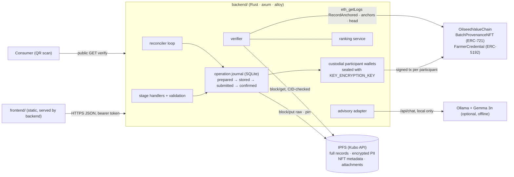

# Architecture

## Components

| Path | Role |
|---|---|
| `contracts/` | Foundry project. `OilseedValueChain` (roles, batches, custody, stage transitions, record anchors, hash chains, fraud review, AI commit–reveal), `BatchProvenanceNFT`, `FarmerCredential`. Tests: unit, fuzz, invariant. |
| `backend/` | API, operation journal, IPFS client, chain client, verifier, rankings, NFT lifecycle, advisory adapter, reconciler. The alloy bindings are generated from `backend/abi/*.json`, which `scripts/export-artifacts.sh` exports from the Foundry build. |
| `frontend/` | Dependency-free ES-module UI: trace and verify, certificates, rankings, advisory, participant workspace, admin. Every view renders API responses only. |
| `scripts/` | `dev-stack.sh` (local anvil + Kubo + deploy + backend), `e2e.sh`, `check.sh`, `export-artifacts.sh`. |
| `legacy/` | Earlier hackathon files kept for reference (see `legacy/README.md`). |

## Storage boundaries

| On-chain (contract storage) | On-chain (event data) | Off-chain |
|---|---|---|
| role bitmap per address; farmer `{registrationDigest, registeredBy, registeredAt}`; batch `{farmerId, parentBatchId, head, custodian, createdAt, stage, recordCount}`; SKU `{batchId, unitsRoot, packagedAt, unitCount}`; anchor `{subjectId, submitter, anchoredAt, recordType}`; AI commit; fraud status; NFT token → record / batch / metadata CID | `RecordAnchored` (digest, contentHash, head, **CID**), `BatchCreated`, `CustodyTransferred`, `StageChanged`, `SkuCreated`, fraud and AI events | **IPFS:** every full record (canonical JSON; declared private fields of farmer registrations and fraud reports AES-256-GCM encrypted, the rest public), NFT metadata, attachments (GPS traces, lab PDFs, IoT roll-ups, label artwork). Every block is queued for backup pinning. **SQLite:** operation journal, participant wallets (sealed), index of farmers, batches and SKUs, unit lists, cached public records for rankings. |

No names, phone numbers, land records, GPS histories, images or JSON documents are written to contract
storage or calldata. Calldata carries ids, hashes and a CID string only. Farmer ids are random 32-byte
values; the link to a real person exists only inside the encrypted registration record.

## Batch lifecycle (enforced by the contract)

`recordProcurement` (FPO) creates a batch in stage `procured` with the FPO as custodian. After that:

* `transferCustody` (current custodian → a participant holding a custodian role)
* `recordWarehouseInspection` (WAREHOUSE role and custodian) → `stored`
* `recordLogistics` (LOGISTICS role and custodian) → `in_transit`
* `processBatch` (PROCESSOR role and custodian) → the input becomes `consumed` (terminal); 1–16 output batches
  are created in stage `processed` with `parentBatchId` set.
* `createSku` (PACKAGER role and custodian; product batches only) → `packaged`. Stores the units' Merkle root.
* `reportFraud` (any participant), then `resolveFraud` (an admin other than the reporter).
* `commitAIAssessment` / `revealAIAssessment` (the same AI_ORACLE, 1 h–24 h window).

Every write anchors a record, extends the batch hash chain and rejects duplicate digests. Consumed batches
reject further records.

## Request lifecycle and failure handling

1. The handler resolves an existing operation for `(actor, Idempotency-Key)` **first**, so a retry after
   success returns the original result. It then validates input and runs pre-checks (role, custody, stage).
2. It builds and canonicalizes the record, computes `contentHash` and `recordDigest`, encrypts it if
   confidential, and computes the raw CID locally.
3. It journals the operation (`prepared`) with the exact payload bytes and the contract call.
4. IPFS `block/put` (pinned, verified against the local CID) → `stored`. An IPFS outage returns 502 and the op
   stays `prepared`.
5. Before sending, it checks the chain for the anchor (or the minted token or commit). If the effect is already
   there, it marks the op `confirmed` and recovers the tx hash from the logs without resending.
6. Send signed by the participant's own key → `submitted` (tx hash persisted). A contract revert during gas
   estimation → `failed` with the custom error name (HTTP 409).
7. Wait up to `TX_CONFIRM_TIMEOUT_SECS` for the receipt. On success the receipt must contain the expected
   `RecordAnchored`; then `confirmed` (200) and the database side effects run (idempotent upserts). Still
   pending → 202; `GET /api/operations/{id}` and the reconciler keep checking. A dropped transaction is
   resent after `TX_DROP_AFTER_SECS`.
8. The reconciler resumes interrupted `prepared` and `stored` ops, retries failed finalization, auto-reveals AI
   commits when chain time enters the window, and marks expired commits.

`/api/workflow/execute` chains the stage services with keys `wf:<key>:<stage>`. It is explicitly not atomic:
it stops at the first unconfirmed stage and resumes when called again with the same key.

## Trust model and centralisation (honest)

* **Custodial keys.** The backend holds each participant's key, sealed at rest. It enforces per-participant
  signing, so contract roles and custody checks are meaningful. But whoever controls the server and
  `KEY_ENCRYPTION_KEY` can sign as any participant. Next steps: participant-held keys, or EIP-712 signed
  intents relayed by the server.
* **Admin.** A single admin EOA grants roles and resolves fraud. Use a multisig in production. An admin cannot
  revoke its own admin role, but there is no timelock.
* **IPFS availability.** Every block the server stores is queued (SQLite `pin_jobs`) for each backup target:
  extra Kubo-compatible nodes (`IPFS_BACKUP_KUBO_URLS`; bytes pushed, CID must match, then read back and
  re-hashed) and/or one IPFS Pinning Service API provider (`IPFS_PINNING_SERVICE_URL`/`_TOKEN`, e.g.
  Pinata's `/psa`; the provider fetches by CID, so the primary node must be reachable from the internet, and
  `pinned` is the provider's word, not re-downloaded). Failures back off exponentially and end as `failed`
  after `IPFS_BACKUP_MAX_ATTEMPTS`; see `GET /api/admin/pins` and each record's `replicas`. Without backup
  targets, content lives on one node. Verification reports missing content as `content_unavailable`.
* **Single instance.** The in-process in-flight lock and SQLite assume one backend instance. Horizontal
  scaling needs a shared database and row-level locking.
* **Rate limiting.** Only a global concurrency limit (64), body-size limits and timeouts are in place. There is
  no per-client rate limit.
* **Data truth.** The chain proves who committed what and when, and that it is unchanged. It does not prove
  the physical facts are true. NFTs and credentials link to that evidence; they do not certify quality.

## Remaining work

Items below have no implementation in this repository; nothing pretends otherwise.

* **Crop prediction / NDVI yield forecasting.** Blocked: no labelled dataset (yield, soil, weather, satellite
  imagery) and no model exist in the repo. A model must be trained and evaluated on real data before an
  endpoint is added.
* **Gemma 3n advisory.** The adapter is implemented, but the model is not bundled. You need a local Ollama
  with `gemma3n:e2b` (or another tag via `ADVISORY_MODEL`). Only the request and response handling are
  tested; the test uses a fake model server, and answer quality is untested.
* **Credit and insurance.** Intentionally absent. The ranking is not a credit score. A credit or insurance
  workflow needs its own validated risk model, consented data and institutional review.
* **External integrations** (Agri-Stack farmer IDs, eNAM prices, Bhuvan/Bhoonidhi imagery). Not
  implemented. `external_farmer_id` is only stored, encrypted.
* **Production hardening.** Non-custodial keys or EIP-712 relaying; a multisig admin; per-client rate
  limiting; multi-instance locking; a real Pinning Service API account (the client is tested only against a
  fake provider); a key-rotation procedure for
  `PII_ENCRYPTION_KEY` / `KEY_ENCRYPTION_KEY`. None of these exist yet.
* **Frontend.** Checked for syntax and exercised through the same API calls by the e2e and smoke tests.
  It has not been checked visually in a browser by automated tests.
